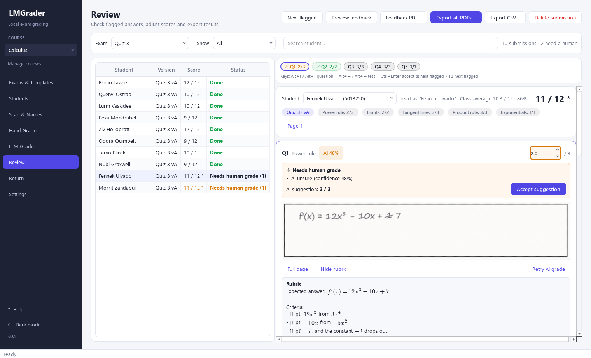
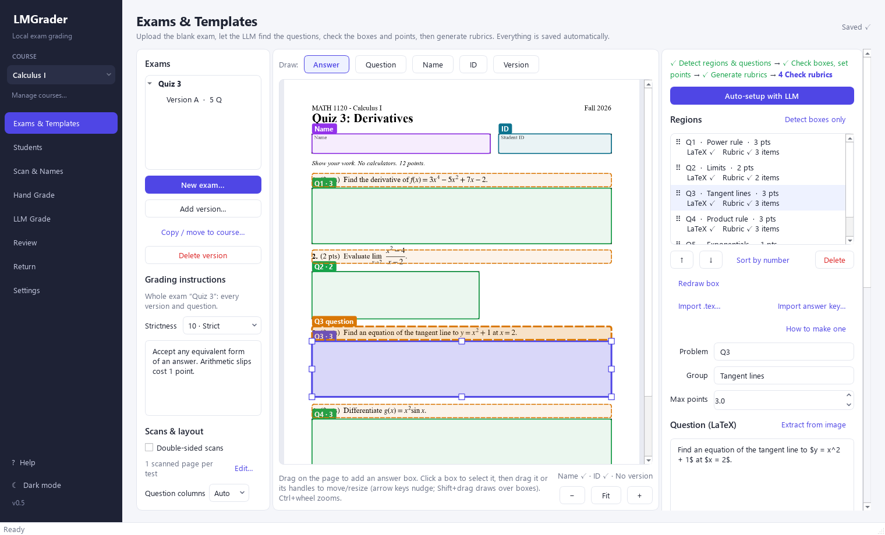
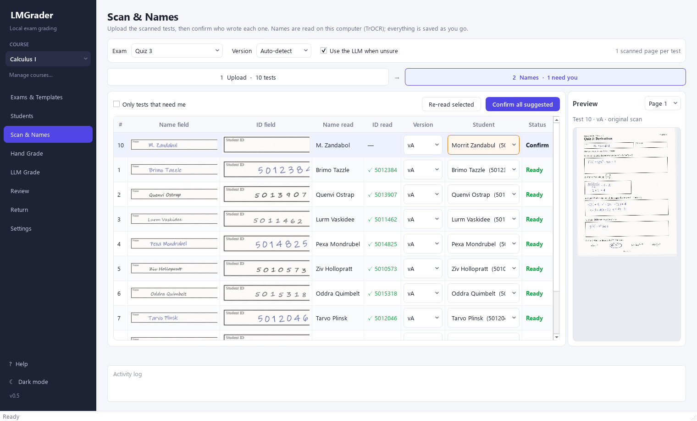
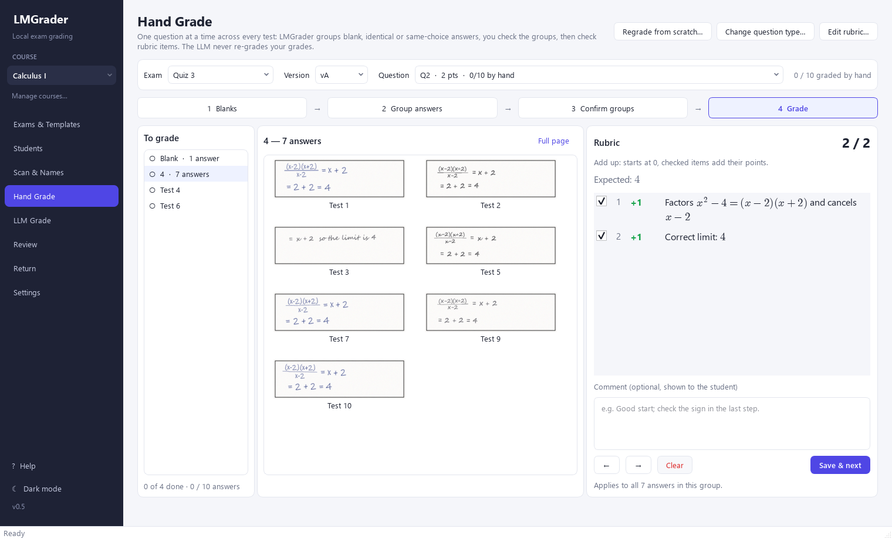
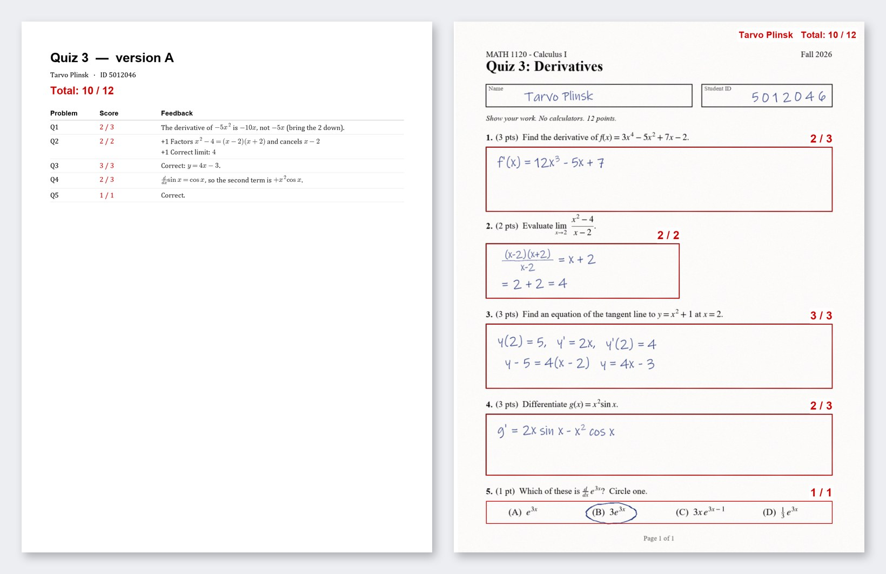

# LMGrader

<picture>
  <source media="(prefers-color-scheme: dark)" srcset="src/lmgrader/ui/assets/lmgrader-logo-dark.svg">
  
</picture>

**Grade paper exams faster, and keep every student's work on your own computer.**

LMGrader is a free desktop app for teachers who grade on paper. Scan the stack of tests and it
finds every answer, reads who wrote each test, and puts answers that read the same together, so
you grade each one once. If you want, an AI running on your own computer grades the rest and
tells you what it isn't sure of. Every student gets a feedback PDF with red marks on their own
pages.

**[Install with Python](docs/install.md)** · [User guide](docs/user-guide.md) ·
[Privacy & FERPA](docs/privacy.md)



## Why LMGrader
- **Grade an answer once, not thirty times.** Hand Grade groups the blank answers, the answers
  that read the same and each marked multiple-choice letter. Tick the rubric items once and the
  whole group is graded. You check every group before it counts.
- **No sorting the stack.** Handwritten names and student IDs are read on your computer and
  matched to your roster. On a real class of 108 tests, 76 were matched with no help and none
  wrong; the rest waited for a quick confirmation. Several versions (A, B, C)? Each scan is
  matched to its version too.
- **The same rubric for everyone.** Rubric items with points, adding up from 0 or deducting from
  full marks. Type them, import them from your exam's LaTeX, or let the AI draft them.
- **An AI assistant, only if you want one.** A vision model in LM Studio, on your own computer,
  grades the questions you didn't grade by hand. It sees only the answer, never the student's
  name. It flags what it is unsure of, and it never changes a grade you gave.
- **Feedback students can use.** One PDF per student: a summary page with every score and
  comment, then their own scan with a red box and score on each question. Upload them all to
  Canvas, write the grades into your gradebook CSV, or save the PDFs to a folder.
- **Private by design.** No account, no cloud service, no LMGrader server.
- **Nothing gets lost.** Every change is saved as you make it. Close the app halfway through, or
  lose power, and pick up where you left off.
- **Free and open source.**

## A quick tour
An invented example: a calculus quiz written by a fictional class. The names are nonsense words
that belong to nobody; student IDs and answers are made up too.

| | |
|---|---|
| **Set up the exam once**: answer boxes, the questions in LaTeX, points and rubric items | **Names read for you**: names and IDs matched to the roster; one test needs you |
|  |  |
| **Grade a group in one click**: these rubric items grade all 7 answers at once | **What students get back**: a summary page, then their own scan with a red box and score on every question |
|  |  |

Every tab, with more screenshots: the [User guide](docs/user-guide.md).

## Get started
Install with Python 3.10 or newer on Windows or Linux. The
[installation guide](docs/install.md) walks through setting up a virtual environment and running
LMGrader.

Then work down the sidebar: pick the **course**, set up the exam in **Exams & Templates**, import
the roster in **Students**, add the scans in **Scan & Names**, grade in **Hand Grade** (and
**LLM Grade**), check in **Review**, and give the tests back in **Return**. Press **F1** in the app
for help on any tab.

More: [Install](docs/install.md) (Python setup, LM Studio, scanning, where your data is) and
the [User guide](docs/user-guide.md) (every tab, step by step, with keyboard shortcuts).

## Privacy
LMGrader is built for FERPA-covered work:
- **No cloud AI.** The AI is optional and runs in LM Studio on your own computer. No scan, name,
  ID or grade is sent to OpenAI, Anthropic, Google or any other AI service.
- **Grading is anonymous.** The AI gets only the crop of the answer box, never the student's name
  or ID. Names are read on your computer and matched to the roster by LMGrader itself.
- **Your data stays with you.** Exams, scans and grades are in a local database in your user
  folder. The Canvas token is kept in the system keyring or only in memory, never in a file.
- **Your institution's systems.** Tests go back through your own Canvas course, with your own
  token.

Details, step by step: [Privacy and FERPA](docs/privacy.md).

## For developers
```
pip install -e .[dev]
python -m pytest -q tests --ignore=tests/test_live_llm.py
```
How it works inside (data model, LLM prompts, grading flow): [docs/DEVELOPER_NOTES.md](docs/DEVELOPER_NOTES.md).

## License
See [LICENSE](LICENSE).
