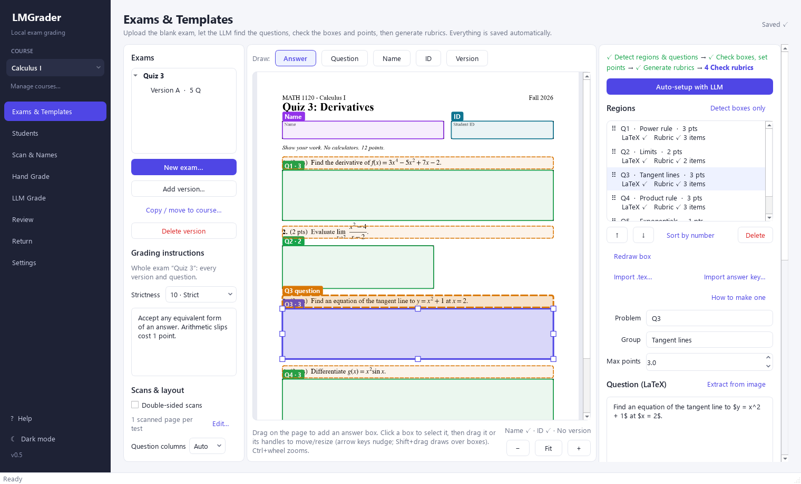
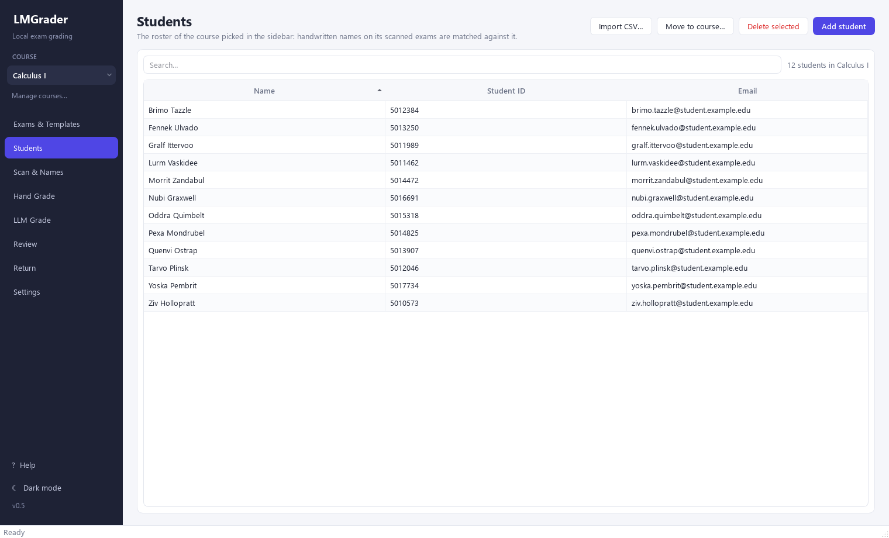
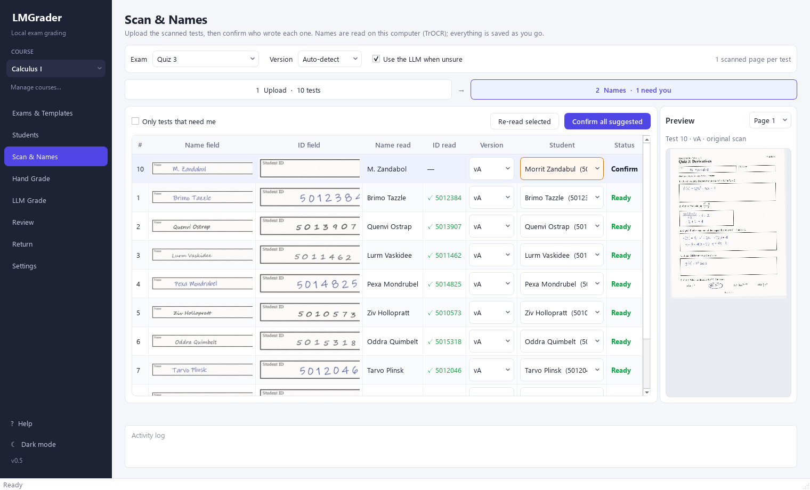
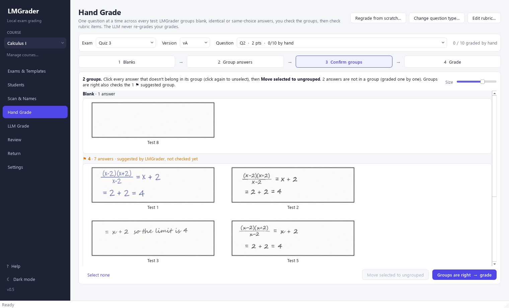
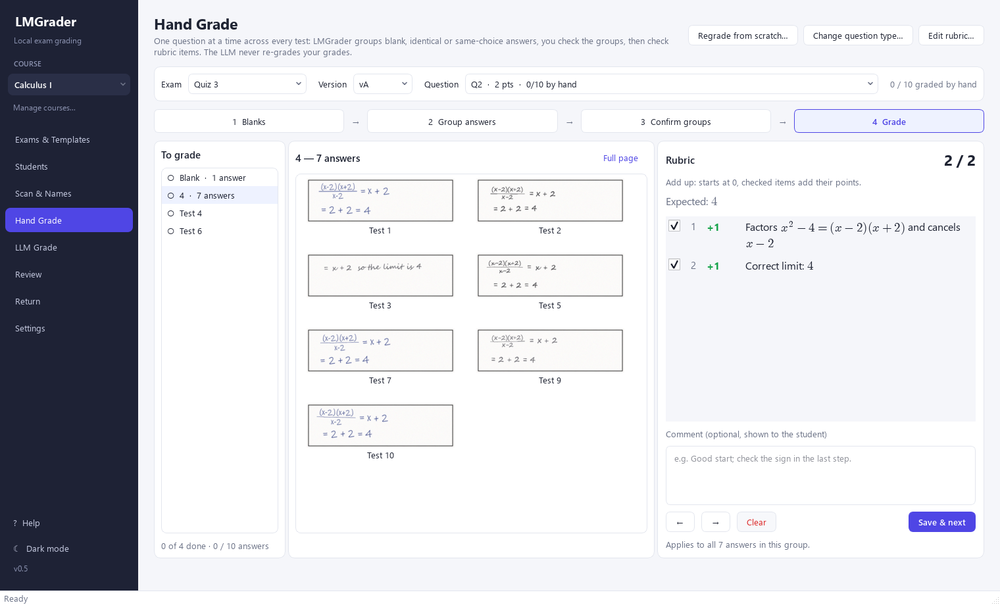
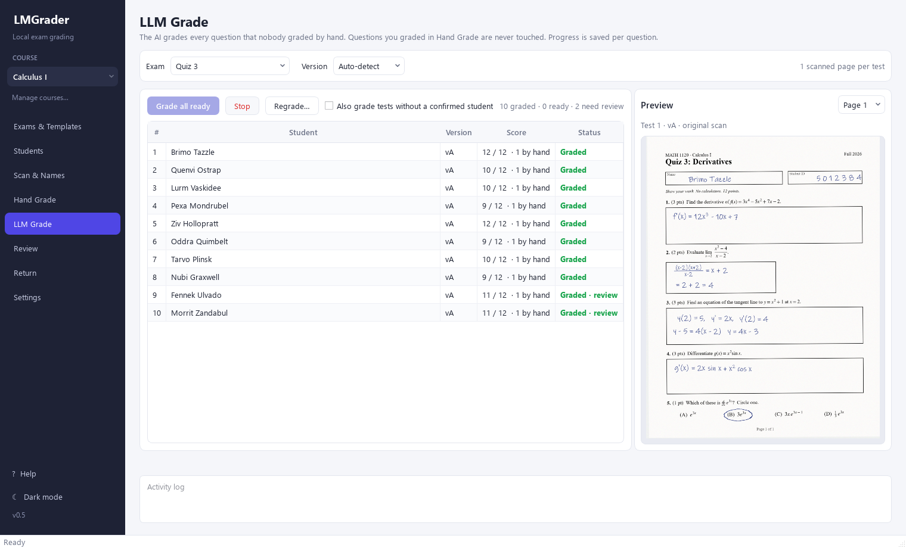
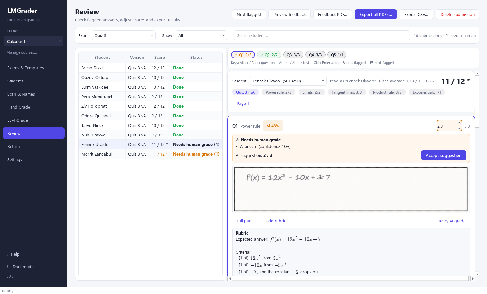
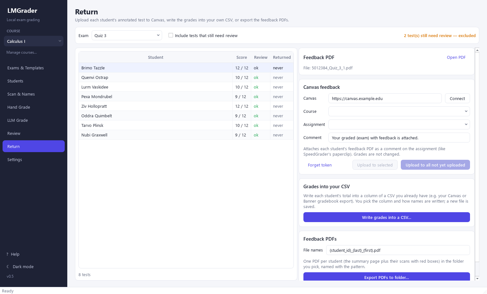
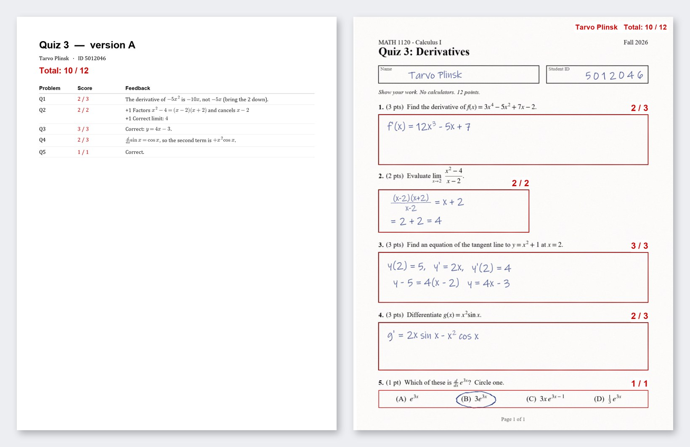

# LMGrader user guide

LMGrader grades paper exams on your computer. You set up an exam once, scan the tests, confirm
who wrote each one, grade, review, and give the tests back with feedback. Work down the sidebar,
top to bottom. Everything is saved as you go: close the app at any time and continue later.

Press **F1** (or **? Help** at the bottom of the sidebar) in the app for help on the tab you are on.

- [Before you start](#before-you-start)
- [1. Course](#1-course)
- [2. Exams & Templates: set up the exam](#2-exams--templates-set-up-the-exam)
- [3. Students: the roster](#3-students-the-roster)
- [4. Scan & Names: add the tests, confirm who wrote them](#4-scan--names-add-the-tests-confirm-who-wrote-them)
- [5. Hand Grade: grade each answer once](#5-hand-grade-grade-each-answer-once)
- [6. LLM Grade: let the AI grade the rest](#6-llm-grade-let-the-ai-grade-the-rest-optional)
- [7. Review: check before you return](#7-review-check-before-you-return)
- [8. Return: give the tests back](#8-return-give-the-tests-back)
- [Settings](#settings)
- [Keyboard shortcuts](#keyboard-shortcuts)
- [Tips](#tips)

## Before you start
You need:
- the **blank exam**: a PDF of it (or a scan of a blank copy), every page;
- the **class roster** as a CSV, e.g. exported from Canvas or Banner;
- the **students' tests**, scanned: one long PDF is easiest (see [Scanning](install.md#scanning)).

An AI is optional. Without one you grade in Hand Grade, and LMGrader still reads the names, groups
the answers and makes the feedback PDFs. To add one, see
[Connect an AI](install.md#connect-an-ai-optional).

## 1. Course
Pick the course at the top of the sidebar. Every tab shows only that course's students and exams.
**Manage courses…** adds and renames courses (an empty course can be deleted). Exams made before courses existed are in
"My course".

Two sections taking the same test? Set the exam up once, then use **Copy / move to course…** in
Exams & Templates to copy it (pages, boxes, questions, rubrics) to the other course.

## 2. Exams & Templates: set up the exam

Tell LMGrader where students answer, what each question is worth and how it is graded.

1. **New exam…**: name it and choose the blank exam (PDF or images, every page). For versions A,
   B, C… use **Add version…**; LMGrader finds each scan's version on its own later.
2. Draw the boxes with the buttons above the page:
   - **Answer**: drag a box around each answer space;
   - **Name** and **ID**: where students write their name and student ID;
   - **Version**: where the exam prints its version, if you have several.

   With an AI, **Auto-setup with LLM** finds the questions, their answer boxes and the name field
   for you, and reads each question as LaTeX. Check the boxes it drew.
3. Select each question in the Regions list. Set its number in **Problem** and its **Max points**.
4. Write the rubric (below).

**Fixing boxes:** click a box to select it, then drag it or its handles. Wrong answer box? Select the
question, press **Redraw box** and drag the new one, on any page; its points and rubric stay.
**Delete** removes the whole question. Drag questions in the Regions list (or ↑ / ↓ / **Sort by
number**) to set their order. Another version with the same layout: **Copy boxes from another
version**.

### Rubrics
Each question has rubric items: points and a description. Pick how they count:
- **Add up (from 0)**: each item you tick while grading adds its points;
- **Deduct (from max)**: the question starts at full marks and each ticked item takes points off.

Ways to fill them in:
- type them: add, delete and drag items to reorder them, at any time, even while grading;
- **Import .tex…**: reads the questions, points and (if your source has them) solutions straight
  from the exam's LaTeX, with no AI (the `exam` class, or numbered `enumerate` lists);
- **Import answer key…**: a JSON answer key with each question's LaTeX, points, answer and rubric.
  **How to make one** installs a Claude Code skill that writes it from your `.tex`;
- with an AI: **Generate all missing rubrics**, then read and edit each one.

For the whole exam (left column): **Double-sided scans** and **Edit…** (page order of one test). With an
AI, **Grading instructions** and **Strictness** apply to every question, and **Notes for the
grader** to one.

Everything is saved automatically ("Saved ✓" at the top right).

## 3. Students: the roster

**Import CSV…** takes any CSV with a header row, e.g. a gradebook export with other assignments in
it. Say which column has the names ("First Last", "Last, First", or first and last name in two
columns) and, if you have them, the student ID and email columns. Other columns are ignored, and
students already in the course are skipped.

**Add student** adds one by hand, **Move to course…** moves the selected students (their tests stay
theirs), **Delete selected** removes them.

## 4. Scan & Names: add the tests, confirm who wrote them

1. Pick the **Exam**. **Version: Auto-detect** finds each test's version.
2. **Add files…**: one long PDF with every test, or several files. LMGrader cuts them into tests of
   the exam's page count. Pages left over wait for the next upload (or **Discard pages**).
   **Scan page** uses a scanner on this computer.
3. Press **Read names**. Handwritten names and IDs are read on this computer and matched to the
   roster. A handwritten student ID is matched first, then the name.
4. In **2 Names**, fix the rows marked **Needs you**: pick the student in the list. Tick **Only tests
   that need me** to see just those. **Confirm all suggested** accepts the rest.

A test read as the wrong version: change it in the Version column. Scans added by mistake: select
them in **1 Upload** and press **Delete**.

## 5. Hand Grade: grade each answer once

Grade one question at a time across every test. Answers that deserve the same grade are grouped,
and you grade each group once.

1. Pick the **Exam**, **Version** and **Question**. The first time, say what kind of question it is:
   - **Blank answers only**: a small model finds the empty answer boxes; you group the other
     answers yourself;
   - **Short answer**: blank answers are found, then answers that read the same are grouped. Best
     for a word or a number; longer work and formulas stay ungrouped;
   - **Multiple choice**: answers are grouped by the choice marked. Check the choice boxes LMGrader
     found on the blank exam once.
2. **1 Blanks**: untick any answer that isn't really blank, then **Confirm blanks →**.
3. **2 Group answers**: suggested groups are marked ⚑. Take out answers that don't belong, then
   **Looks right ✓**. Group others yourself: click answers to select them (click again to unselect,
   or drag a box around several), then **New group from selection** or **Add selection to group**.
   **Dissolve group** also deletes the hand grades of its answers.
4. **3 Confirm groups** shows every group with all its answers. Click the ones that don't belong and
   **Move selected to ungrouped** (they are graded one by one), then **Groups are right → grade**.
5. **4 Grade**: tick rubric items (keys **1**–**9**), add a comment if you like, then **Save & next**
   (**Ctrl+Enter**). One save grades the whole group. Groups come first, then single answers.

When the question is done, a message says so: **Go to** the next question or **Stay on** this one.

- **Edit rubric…** changes rubric items while grading.
- **Suggest groups…** sorts tests you scanned later.
- **Regrade from scratch…** starts the question over with the same type; **Change question
  type…** starts it over as another type. Either way its groups and hand grades are deleted, after
  asking.
- The AI never changes a grade you give here.

## 6. LLM Grade: let the AI grade the rest (optional)

Shown when *Use an LLM* is on in Settings. The AI grades every question nobody graded by hand,
using the question, its rubric and your grading instructions. It sees only the answer box, never
the student's name. Progress is saved after every question.

- **Grade all ready** grades the tests whose student is confirmed (tick **Also grade tests without a
  confirmed student** for the rest). **Stop** at any time; it continues where it stopped.
- Answers the AI is unsure about, work that continues on the back of the page and poor scans are
  marked **Needs human grade** for Review.
- **Regrade…** grades the selected (or all) tests again, e.g. after you change a rubric. You choose
  whether hand-graded questions are kept.

## 7. Review: check before you return

Flagged questions need you: the AI's score is only a suggestion until you accept it or type your
own.

- Pick a test on the left (**Show: Needs human grade** lists only those).
- The chips above the questions show every question: ⚠ needs you, ✓ graded by a person, no mark =
  AI grade. Click one to jump to it.
- Type a score to set your grade, or press **Accept suggestion**. Edit the feedback the student will
  read.
- **Full page** and **Back of page** show the whole scan; **Show rubric** shows the rubric;
  **Retry AI grade** asks the AI again.
- **Next flagged** (**F3**) goes to the next question that needs you, then to the next test.
  **Ctrl+Enter** accepts the suggestion and goes on.
- **Preview feedback** shows the first page the student gets. The header shows the class average.

## 8. Return: give the tests back

Each student gets a feedback PDF: a first page with every question's score and feedback, then
their own scans with a red box and score on each question.

- **Canvas feedback**: enter your Canvas address, **Connect** with a personal access token (Canvas:
  Account → Settings → New access token), pick the course and the assignment, then **Upload to all
  not yet uploaded**. Each PDF is attached to the student's submission as a comment. Canvas grades
  are not changed.
- **Grades into your CSV**: **Write grades into a CSV…** fills a column of a gradebook CSV you already
  have (e.g. a Canvas export): pick the column and how names are written. It is matched by student
  ID, then by name, and saved as a new file.
- **Feedback PDFs**: **Export PDFs to folder…** saves one PDF per student, named by the pattern.

Tests that still need review are left out unless you tick **Include tests that still need
review**. The **Returned** column shows what already went out, so nothing is sent twice.

## Settings
- **Appearance**: Light, Dark or Follow Windows (also the button at the bottom of the sidebar).
- **Use an LLM**: off by default. While it is off, LMGrader never contacts an AI: the AI buttons and
  the LLM Grade tab are hidden. Turn it on to connect LM Studio (see
  [Connect an AI](install.md#connect-an-ai-optional)).
- **Human grading**: below which AI confidence a question goes to you in Review.

Press **Save** to keep your changes.

## Keyboard shortcuts
| Where | Keys | What |
|---|---|---|
| Everywhere | F1 | help for the tab you are on |
| Hand Grade | 1 … 9 | tick / untick rubric item 1 … 9 |
| | Ctrl+Enter | save the grade and go to the next one |
| | Alt+← / Alt+→ | previous / next answer without saving |
| | Esc | unselect every answer |
| Review | Alt+↑ / Alt+↓ | previous / next question of this test |
| | Alt+← / Alt+→ | previous / next test |
| | Ctrl+Enter | accept the AI suggestion (or keep the score you typed) and go to the next flagged question |
| | F3 | next flagged question |
| Exams & Templates | arrow keys | nudge the selected box |
| | Shift+drag | draw a new box on top of existing boxes |
| | Delete | delete the selected question (in the Regions list) |
| | Esc | keep the old box while redrawing one |
| | Ctrl+wheel | zoom the page |

The mouse wheel only scrolls: it never changes a number box or a list.

## Tips
- **Leave space for the name.** A clear box for the name (and one for the student ID) makes name
  reading much more reliable. IDs are matched first.
- **One answer per box.** Boxes that hold exactly one question's answer group and grade best.
- **Grade by hand what groups well.** Multiple choice and one-word or one-number answers group
  well. With an AI on, LLM Grade takes the questions you didn't grade by hand, and every answer
  it is unsure of still comes to you.
- **Back up** your data folder ([where it is](install.md#where-your-data-is)) before the end of the
  term.
